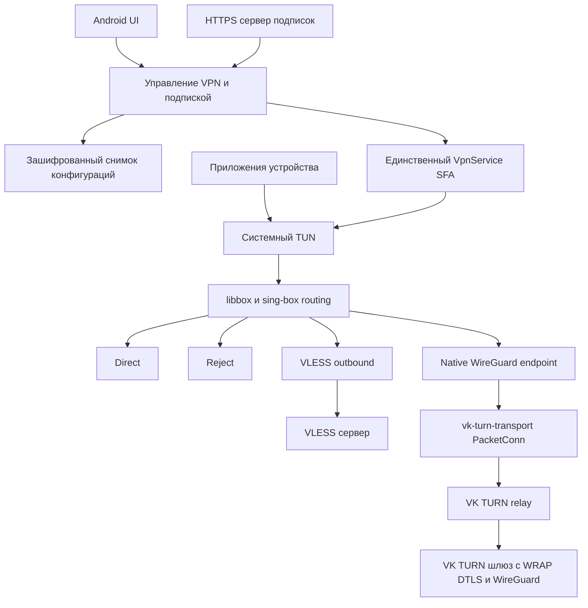

# Спецификация Android клиента с VLESS и VK TURN

Дата: 14 октября 2026 года. Статус: проект спецификации первой версии.

Создать Android-приложение с функциональностью ветки `codex/vk-turn-routing-prototype`: получение двух конфигураций по одной подписке, ручной выбор VLESS или VK TURN, единая маршрутизация, подключение VPN, логи и диагностика. Основой приложения служит оригинальный sing-box for Android, сетевым ядром — sing-box. Из SpaceNeuroX/proxy-turn-vk-android заимствуется реализация VK TURN и совместимого протокола обмена с сервером.

Ключевое решение: один Android `VpnService`, один системный TUN и одно Go-ядро libbox. WireGuard и маршрутизацией управляет sing-box; заимствованный TURN-код отвечает только за транспорт и получение параметров подключения. Сервер подписок выдаёт настройки, а пользовательский трафик проходит через отдельные VLESS- и VK TURN-шлюзы.

## Цель и границы первой версии

Пользователь вставляет ссылку подписки, получает доступные режимы, выбирает режим и подключает VPN. После успешного импорта приложение запускается из сохранённых настроек без обязательного обращения к серверу подписок. Изменение выбранного режима при активном VPN выполняет остановку старого туннеля и запуск нового.

В первую версию входят:

- Один сохранённый набор конфигураций: один VLESS outbound и одна конфигурация VK TURN.
- Подписка с полями `sing_box_url` и `vk_turn_link`; ручной импорт JSON и поддерживаемой TURN-ссылки.
- VLESS с параметрами TLS, REALITY и Vision, поддерживаемыми выбранной версией sing-box.
- VK TURN в режиме WireGuard поверх согласованного WRAP/DTLS-транспорта; анонимное получение TURN credentials.
- Общие правила `direct`, `reject` и направления через выбранный режим; встроенные локальные rule sets.
- Подключение, отключение, ручное переключение, восстановление того же режима после смены сети.
- Отображение состояния, скорости, трафика, активных TURN-соединений, логи и экспорт диагностического CSV.
- Диагностический режим прямого подключения без TURN/WireGuard, явно обозначенный в интерфейсе.

За пределами первой версии: автоматический failover между VLESS и TURN, несколько профилей, обновление rule sets по сети, raw-IP режим qWDTT, встроенный SOCKS-сервер, VK account/cookie авторизация, управление серверами из приложения, платежи и личный кабинет. Полноценный IPv6 через прокси не входит в первую версию; его обход вне VPN должен быть заблокирован и проверен отдельно.

Предлагаемый минимум — Android 7.0/API 24. Начальные ABI: `arm64-v8a` для устройств и `x86_64` для эмулятора. Это проектное ограничение первой версии; оригинальный SFA также имеет отдельный legacy flavor. `compileSdk`, `targetSdk`, JDK, Gradle и NDK берутся из выбранной совместимой версии SFA, а не назначаются независимо от неё.

## Исходные проекты и выбор подхода

| Источник | Что использовать | Что не переносить в сетевой тракт |
| --- | --- | --- |
| [SagerNet/sing-box-for-android](https://github.com/SagerNet/sing-box-for-android) | VPNService, BoxService, platform interface, монитор сети, уведомления, обмен состояния с UI, существующие настройки | Дополнительный параллельный VPN-сервис |
| [SagerNet/sing-box](https://github.com/SagerNet/sing-box) | libbox, TUN/gVisor, маршрутизация, DNS, VLESS, native WireGuard endpoint | Второе независимое ядро обработки трафика |
| [SpaceNeuroX/proxy-turn-vk-android](https://github.com/SpaceNeuroX/proxy-turn-vk-android) | TURN allocations, VK credentials, RTP/WRAP, DTLS, GETCONF, управление транспортными соединениями | CLI, subprocess, собственный TUN, отдельный WireGuard backend, SOCKS и raw-IP |
| Локальная ветка prototype | Адаптер `protocol/vkturn`, построение конфигурации, отмена bootstrap, переключение режимов, импорт подписки | SwiftUI, NetworkExtension, Mach memory sampler и Apple-specific runtime patches |

Основной вариант — небольшой форк SFA с модифицированным libbox. Он сохраняет готовую платформенную интеграцию и повторяет архитектуру prototype. Новый Kotlin-клиент только поверх libbox потребовал бы повторно реализовать VPN lifecycle и IPC. Соединение двух готовых приложений через loopback UDP/SOCKS добавило бы отдельный процесс и усложнило остановку, диагностику и обход собственного VPN; такой вариант не входит в целевую архитектуру.

В qWDTT каталог `go_client` сейчас представляет `package main` с CLI, stdin/stdout-командами и собственным жизненным циклом. Его нужно преобразовать в импортируемый Go-пакет. Готовый `libclient.so` из этого проекта не используется вместе с libbox. Основание: [go_client/main.go](https://github.com/SpaceNeuroX/proxy-turn-vk-android/blob/a296c57eaba69bb9479a24f9157856490890e47d/go_client/main.go), [сборка клиента](https://github.com/SpaceNeuroX/proxy-turn-vk-android/blob/a296c57eaba69bb9479a24f9157856490890e47d/scripts/build-go-lib.sh).

В качестве исследованных исходных точек зафиксированы SFA `bc73504fcb858400a939140ad785ed92f4c9f429` и qWDTT `a296c57eaba69bb9479a24f9157856490890e47d`. Локальный core prototype основан на `af6e64c3b69e6132ebaee0e1a3d24e93903f6709` с незакоммиченными изменениями. Эти SHA описывают источники дизайна, а не проверенную совместимую комбинацию для Android-релиза. Для реализации выбрать согласованную пару SFA/core и зафиксировать её вместе с TURN-кодом; не собирать релизы с плавающих `dev`, `master` или `testing`.

## Библиотеки и инструменты

| Область | Выбор | Назначение |
| --- | --- | --- |
| Android | Kotlin, Gradle Kotlin DSL, Gradle Wrapper из SFA | Приложение и воспроизводимая сборка |
| UI | Jetpack Compose, Material 3, AndroidX Lifecycle/ViewModel | Экран подключения, настройки и логи; использовать уже подключённые компоненты SFA |
| Асинхронность | kotlinx.coroutines, Flow/StateFlow | Состояние UI, отмена операций, последовательное выполнение команд |
| JSON | kotlinx.serialization-json в Kotlin; `encoding/json` в Go | DTO подписки и настройки; поля VLESS сохранять без потери неизвестных поддерживаемых core параметров |
| Настройки | Существующие Settings/Room из SFA | Метаданные и пользовательские настройки; не добавлять вторую БД |
| Секреты | Android Keystore и `javax.crypto` AES-GCM | Шифрование локального снимка подписки и credentials |
| Сетевое ядро | sing-box `experimental/libbox`, `github.com/sagernet/gomobile` | Один `libbox.aar`, bindings между Kotlin и Go |
| Пользовательский трафик | VLESS, WireGuard endpoint, DNS и gVisor из sing-box | Повторно использовать сетевой стек core |
| TURN | `github.com/pion/turn/v5`, `github.com/pion/transport/v4` | Использовать версии, совместимые с извлечённым TURN-кодом |
| DTLS | `github.com/pion/dtls/v3` | Согласованный транспорт до VK TURN-шлюза |
| WRAP | `golang.org/x/crypto` | HKDF и ChaCha20-Poly1305 из заимствуемой реализации |
| HTTP к VK | `github.com/bogdanfinn/fhttp`, `github.com/bogdanfinn/tls-client` | Сохранить необходимые свойства VK credentials flow; не заменять вслепую обычным HTTP-клиентом |
| HTTP подписки | HTTP-слой libbox/SFA на основе Go `net/http` | Добавить контроль статуса, размера, таймаута и redirects; отдельный Retrofit не требуется |
| Сервер подписок | Python 3, `http.server`, `json`, `hmac`, `secrets`, `pathlib` | Переиспользовать существующий сервер без сторонних Python-пакетов |
| Публичный HTTPS | Caddy 2 | TLS termination и reverse proxy перед сервером подписок |
| Проверки | Go testing/race, JUnit, Android instrumentation/Compose tests, Python unittest | Протокол, lifecycle, UI, API и реальные сетевые сценарии |

Стек UI, Room, Coroutines и serialization уже присутствует в [зависимостях SFA](https://github.com/SagerNet/sing-box-for-android/blob/bc73504fcb858400a939140ad785ed92f4c9f429/app/build.gradle.kts). TURN/DTLS/TLS-библиотеки перечислены в [go_client/go.mod](https://github.com/SpaceNeuroX/proxy-turn-vk-android/blob/a296c57eaba69bb9479a24f9157856490890e47d/go_client/go.mod). Версии переносить из зафиксированных исходников и согласовывать через единый `go.mod`/`go.sum`: два независимых набора зависимостей для двух Go runtime не нужны. Отдельная Android WireGuard Tunnel library и tun2socks не требуются.

## Архитектура и движение данных



В режиме VK TURN маршрут данных: Android TUN → sing-box/gVisor → route → native WireGuard → адаптер TURN → WRAP/DTLS → VK TURN → шлюз. В режиме VLESS: Android TUN → sing-box/gVisor → тот же route → VLESS → VLESS-сервер. В каждый момент активен один режим. Direct/reject обрабатываются в sing-box независимо от выбранного режима.

Kotlin передаёт через bindings команды, настройки, события и статистику. Отдельные IP-пакеты через Kotlin/JNI не передаются: обмен между WireGuard и TURN остаётся внутри одного Go runtime. TUN descriptor принадлежит платформенной интеграции SFA/libbox; TURN-библиотека не открывает и не закрывает его.

## Выделение TURN транспорта

Создать импортируемый пакет транспортного слоя из `go_client`, например `third_party/vkturn`. Сохранить upstream происхождение и возможность обновлять код отдельно от интеграционного адаптера. Перенести только используемые файлы и зависимости; runtime-код CLI не должен попасть в API библиотеки.

Требуемый внутренний Go-контракт:

```go
type Session interface {
    Provision(ctx context.Context) (WireGuardProvision, error)
    SendPacket(ctx context.Context, packet []byte) error
    ReceivePacket(ctx context.Context, dst []byte) (int, error)
    Stats() TransportStats
    Close() error
}
```

Это предлагаемый интерфейс адаптации, а не существующий API qWDTT. `WireGuardProvision` содержит ключи, CIDR-адрес, допустимый MTU и keepalive. Транспорт принимает и возвращает WireGuard datagrams после обработки собственного WRAP/DTLS, не IP-пакеты приложения. Во внутренние настройки также передаются защищённый socket dialer, resolver, обработчик событий и стабильный случайный device ID.

Обязательные изменения при извлечении:

1. Заменить `main`, `flag`, чтение stdin, `os.Exit` и `log.Fatal` на настройки, ошибки и callbacks.
2. Не менять глобальный `net.DefaultResolver`, процессные переменные среды или глобальный logger ради одной сессии.
3. Удалить зависимость от loopback listener, локального SOCKS, raw TUN и самостоятельного userspace WireGuard.
4. Заменить CLI-выдачу WG-конфига на структурированный результат provisioning. Приватные ключи и полный ответ GETCONF не печатать.
5. Ограничить очереди передачи и приёма; поддержать отмену, deadlines и закрытие без ожидания заполненной очереди. При превышении срока UDP packet может быть отброшен, как в prototype.
6. Убрать бессрочные глобальные кэши AEAD/credentials либо сделать их ограниченными и привязанными к сессии.
7. Разделить внутренние keepalive/control frames и WireGuard datagrams; управляющие сообщения не должны попадать в WireGuard endpoint.

Получение credentials и provisioning выполняются до запуска WireGuard. При нескольких TURN connections каждая проходит требуемую сервером авторизацию, а provision для одной сессии должен быть согласован. Различающиеся ключи или адреса считаются ошибкой; нельзя молча использовать данные последнего ответа.

## Интеграция с sing-box

Использовать структуру prototype: зарегистрировать пользовательский UDP outbound `vk-turn-transport`, который выдаёт адаптер `net.PacketConn` поверх активной TURN-сессии. Native WireGuard endpoint использует этот outbound через `detour`.

Адаптер сохраняет границы datagrams, поддерживает `ReadFrom`, `WriteTo`, read/write deadlines, корректное закрытие и стабильную адресную идентичность peer. Он относится к конкретной сессии; произвольный session ID из импортированного JSON не разрешает доступ к чужой сессии. Окончательную привязку к API outbound и WireGuard выполнить для выбранной версии core.

В prototype WG peer представлен фиктивным `127.0.0.1:51820`: реальный транспорт направляет datagrams через TURN. Это служебный адрес конфигурации, а не дополнительный loopback proxy. Endpoint из полученного серверного INI не нужно открывать как реальный локальный сервер; из ответа извлекаются согласованные параметры WireGuard.

Libbox предоставляет операции начала поколения, bootstrap, чтения статистики, отмены и остановки. Bindings передают примитивные значения, DTO и callbacks; `context.Context` и Go-указатели не выставляются непосредственно в Kotlin. Блокирующие операции выполняются вне main thread.

Критический invariant: переключение и stop инвалидируют generation. Запоздалый bootstrap не регистрирует транспорт и не запускает старый режим. `Stop` идемпотентен, освобождает все TURN allocations, callbacks, sockets и workers. После остановки должна сохраняться только ограниченная история диагностики.

## Совместимость с VK TURN шлюзом

qWDTT содержит несколько режимов и развивается отдельно от iOS-библиотеки. Совпадение названия WRAP или схемы `wdtt://` не является подтверждением совместимости. Первая версия фиксирует профиль совместимости: WireGuard, audio RTP framing, WRAP с паролем, DTLS и GETCONF. Video framing, `NoDTLS`, RAWCONF и account auth не включаются автоматически.

В исследованном коде видны общие основы: HKDF-SHA256 с salt `WDTT-WRAP-v1`, info `rtp-obfs/chacha20poly1305`, а также запрос `GETCONF:<port>|<deviceID>|<password>`. Однако при переносе необходимо проверить RTP header/AAD, nonce, padding, sequence/timestamp, replay protection, DTLS, keepalive и ответы авторизации. Источники: [wrap.go](https://github.com/SpaceNeuroX/proxy-turn-vk-android/blob/a296c57eaba69bb9479a24f9157856490890e47d/go_client/wrap.go), [obfs.go](https://github.com/SpaceNeuroX/proxy-turn-vk-android/blob/a296c57eaba69bb9479a24f9157856490890e47d/go_client/obfs.go), [protocol.go](https://github.com/SpaceNeuroX/proxy-turn-vk-android/blob/a296c57eaba69bb9479a24f9157856490890e47d/go_client/protocol.go).

Подготовить фиксированные тестовые векторы и двусторонние проверки с выбранным серверным commit. Проверить получение WG provision, передачу WireGuard datagrams и фактический TCP/UDP-трафик. До прохождения этих проверок нельзя заявлять, что Android-клиент работает с существующим iOS-шлюзом.

Один пароль шлюза может быть привязан к одному device ID. Android генерирует собственный ID установки, не копирует ID iPhone. Для двух устройств оператор выдаёт отдельные credentials или настраивает разрешённую сервером многопользовательскую привязку. Токен HTTP-подписки и пароль GETCONF — разные секреты.

## Android VPN и работа с сетью

Сохранить инфраструктуру SFA: `VPNService`, `BoxService`, platform interface и default network monitor. Foreground notification должна появляться до долгого bootstrap, а не после него. Результат VPN permission, `onRevoke`, stop из уведомления и уничтожение сервиса входят в общий lifecycle. Не выполнять TURN bootstrap в UI или через WorkManager.

Android требует исключать транспортные sockets из собственного VPN через `VpnService.protect(fd)`. SFA уже делает это в `autoDetectInterfaceControl`, но заимствованные `net.DialUDP`, `net.Dialer` и нестандартные HTTP/TLS-клиенты сами по себе не используют этот callback. Все внешние sockets TURN, VK HTTP/TLS и bootstrap DNS должны проходить общую фабрику защиты до connect/начала обмена. Ошибка `protect` прекращает создание соединения; нельзя продолжать с незащищённым socket. Источники: [SFA VPNService](https://github.com/SagerNet/sing-box-for-android/blob/bc73504fcb858400a939140ad785ed92f4c9f429/app/src/main/java/io/nekohasekai/sfa/bg/VPNService.kt), [Android VPN API](https://developer.android.com/develop/connectivity/vpn).

Использовать Go dialer/ListenConfig с control callback и платформенный resolver, связанный с выбранной сетью. Если HTTP/TLS-библиотека скрывает собственный dialer, её необходимо адаптировать. Не решать проблему исключением всего приложения или сторонних VK-приложений из VPN: это меняет routing пользовательского трафика. `protect` защищает от петли, а привязка к underlying `Network` отвечает за выбор физической сети; эти задачи различаются.

Монитор сети исключает VPN-интерфейс из кандидатов. При Wi-Fi ↔ mobile смене он обновляет core и перезапускает либо перепривязывает TURN-сессию. На первой версии допустим сериализованный перезапуск того же режима с backoff 1, 2, 4, 8, 16, 30 секунд. При отсутствии сети ожидать callback, а не непрерывно опрашивать VK. Ошибки пароля, истечения доступа, device mismatch и несовместимого протокола не повторяются автоматически.

Политику Doze/idle перенести из выбранного SFA и согласовать с TURN keepalive: pause не должен оставлять UI в ложном состоянии «подключено». После wake проверить передачу данных; при утрате allocations восстановить сессию. Требования foreground service type и permissions берутся из manifest выбранного SFA и проверяются на соответствующих Android API.

## Маршрутизация и DNS

Подписка поставляет только connection settings. Приложение формирует TUN, route, DNS и пути локальных rule sets. Импортированные `inbounds`, `route`, `dns`, сторонние outbounds, административные API и filesystem paths не применяются.

Для совпадения с prototype перенести исходные правила, их порядок и локальные `.srs`; ссылки исходного target `R3-N1` нормализовать на один внутренний target, например `proxy`. В VLESS этот tag принадлежит VLESS outbound, в VK TURN — WireGuard endpoint. Сохранить direct/reject, sniff и DNS hijack правила. `route.final` также указывает на активный proxy: неописанный трафик идёт через выбранный режим.

Первая версия использует встроенные rule sets без загрузки перед подключением; для них фиксируются происхождение, SHA-256 и версия формата. Локальные пути создаёт приложение. Пользовательский конфиг не может заставить core читать произвольный файл.

DNS пользовательских запросов проходит через выбранный proxy; для hostname VLESS-сервера и инфраструктуры VK/TURN применяется отдельный bootstrap resolver вне туннеля. В базовом диагностическом режиме DNS прямой. DNS провайдера для всех пользовательских запросов не становится скрытым fallback при отказе proxy.

Начальный TUN MTU — 1280. WireGuard MTU из provision проверяется, для первой версии допустим диапазон 1280–1500; итоговый размер проверяется на реальной TURN path с учётом накладных расходов. Настройки из существующего prototype служат стартовой точкой, а не результатом измерения Android.

IPv6 вне поддерживаемого прокси не допускается: VPN plumbing блокирует неподдерживаемое семейство, DNS использует IPv4-политику. Проверять обход отдельно на IPv6-only/dual-stack сетях. Первая версия может отказать в подключении на сети, где отсутствует работоспособный путь к выбранному серверу; нельзя маскировать это выпуском IPv6 напрямую.

`direct` — явное исключение route и ожидаемое поведение. Ручное отключение или перезапуск режима без системного lockdown может временно вернуть устройству обычную сеть; бесшовное переключение и kill switch приложением не обещаются. Android always-on/lockdown проверяется отдельно, включая совместимость с bootstrap и direct правилами.

## Импорт и локальное хранение

VLESS importer принимает строгий JSON-объект: один raw VLESS outbound либо объект с `outbounds`. Выбирать VLESS с tag `R3-N1`, если он единственный с этим tag; иначе единственный VLESS. Неоднозначный набор отклоняется. Проверять server, целочисленный port 1–65535, UUID и отсутствие `detour`; прочие параметры сохранять и валидировать через реальный sing-box core.

TURN importer поддерживает `wdtt://` и `vkturnproxy://import?data=…` в пределах зафиксированного профиля совместимости. Парсер переносится с тестовыми примерами из prototype и qWDTT; неизвестные режимы не преобразуются наугад. Проверять endpoint, VK URL, пароль или WG keys, число соединений и запрет управляющих символов. Успешный разбор ссылки ещё не подтверждает доступность шлюза.

Снимок подписки содержит URL источника, доступные connection settings и время успешной загрузки. Шифровать его AES-GCM ключом Android Keystore, хранить в приватном каталоге приложения, записывать атомарно. Секретные поля не хранить открыто в обычных preferences/Room. Исключить снимок, device ID и runtime secrets из Android backup; после переустановки учитывать новую серверную device binding.

Настройки режима и UI хранить существующим механизмом SFA. Runtime WG provision и TURN credentials держать в памяти; если нужен ограниченный кэш, он шифруется и имеет срок годности. Потеря Keystore ключа или повреждение снимка приводит к состоянию «требуется повторный импорт» без запуска с частичным конфигом.

## Состояние и интерфейс

Один service controller выполняет команды connect, disconnect, switch и network restart последовательно. UI отображает его состояние, а не считает нажатие кнопки успешным подключением.

| Состояние | Поведение |
| --- | --- |
| Disconnected | Выбор доступного режима, импорт и обновление подписки |
| Preparing | Проверка конфигурации и VPN permission |
| Bootstrapping | TURN credentials/GETCONF или подготовка VLESS; доступны отмена и stop |
| Connecting | Запуск libbox и TUN |
| Connected | Трафик, статистика, отключение и переключение |
| WaitingForNetwork | Сохранён выбранный режим, ожидание underlying network |
| Reconnecting | Восстановление того же режима с ограниченными попытками |
| Stopping | Все start/switch блокируются до завершения остановки |
| Error | Понятная причина; данные последней подписки сохраняются |

В offline состоянии смена режима только сохраняет выбор. В connected — останавливает старый режим, ждёт освобождения ресурсов и запускает выбранный. Повторный выбор активного режима ничего не делает. При stop во время bootstrap отменяются сетевые операции и generation. Таймаут остановки — 15 секунд; при превышении показывать ошибку и не запускать второй core.

Экран подключения содержит статус, доступные режимы, кнопку подключения, скорость и объём данных. Настройки содержат ссылку подписки, обновление, ручной импорт, число TURN connections и очистку. Не имеющий конфигурации режим disabled с объяснением. TURN-specific настройки disabled в VLESS. Число workers/allocations не должно выдавать себя за то же число, что в iOS: qWDTT группирует workers; адаптер нормализует значение явно и показывает фактические allocations.

Капча оформляется отдельным отменяемым событием «требуется действие». Если нужен WebView, использовать ограниченный экран существующего Android WebView, проверенные origins и минимальный callback результата. До завершения такого flow приложение не сообщает об успешном подключении; stop инвалидирует старый результат. VK account login не входит в первую версию.

## Протокол подписки

Сохранить контракт prototype без названия тарифа, оставшихся дней, версии схемы или встроенного sing-box JSON:

```http
GET /subscription/{token}
```

```json
{
  "sing_box_url": "https://subscriptions.example.com/subscription/EXAMPLE_TOKEN/config",
  "vk_turn_link": "wdtt://EXAMPLE_CONNECTION"
}
```

Значения в примере обозначают формат, а не рабочие credentials. Оба поля — `string | null`. Пустое или отсутствующее поле считается отключённым режимом для совместимости с prototype. Неизвестные поля можно игнорировать; объект другого типа отклоняется.

По `sing_box_url` клиент выполняет второй GET и получает connection-only JSON:

```json
{
  "type": "vless",
  "server": "vpn.example.com",
  "server_port": 443,
  "uuid": "11111111-1111-4111-8111-111111111111"
}
```

TLS/REALITY/flow и transport параметры добавляются оператором согласно реальному серверу. Пример не задаёт безопасную производственную конфигурацию. Можно выдать объект с `outbounds`, который importer обрабатывает по правилам выше.

Алгоритм обновления:

1. Разрешить обновление только в Disconnected, чтобы воспроизвести prototype и избежать доступа к локальному серверу через изменяющийся VPN.
2. Проверить HTTP(S) URL без userinfo/fragment; для release разрешён HTTPS. Локальный HTTP включается только в debug-конфигурации для доверенной LAN.
3. Скачать manifest: таймаут отдельного запроса 10 секунд, общий бюджет обновления 30 секунд, лимит body 128 КиБ. Лимиты применять при чтении, включая распакованный body, до JSON parse.
4. Если есть `sing_box_url`, скачать JSON с лимитом 8 МиБ. Redirects на обоих запросах отклонять. Для первой версии config URL должен иметь тот же HTTPS origin, что manifest; сторонний CDN требует отдельного расширения политики.
5. Валидировать поля и импортированные режимы, подготовить полный новый снимок, затем атомарно заменить старый.

При network error, TLS error, redirect, HTTP не-200, превышении размера или повреждённом manifest оставить предыдущий снимок целиком. HTTP-ошибка config download также сохраняет предыдущий снимок. При успешной загрузке JSON с некорректным VLESS или некорректной TURN-ссылкой соответствующий режим отключается с предупреждением; валидный второй режим сохраняется. Это повторяет поведение importer prototype. Успешный ответ с двумя null очищает оба режима; это отличается от ошибки загрузки.

Если текущий режим исчез после успешного обновления, выбрать доступный; если нет ни одного — заблокировать connect. Само обновление VPN не запускает. После перезапуска приложения snapshot позволяет подключаться без сервера подписок.

Отзыв HTTP-токена запрещает будущие обновления, но не аннулирует уже скачанные VLESS/WG credentials и действующую VPN-сессию. Реальное отключение доступа выполняется на соответствующем VPN-шлюзе.

## Реализация сервера подписок

Основой служит существующий `subscription-server/server.py`. Он уже выдаёт два поля, отдельный config endpoint, перечитывает `.env` и скрывает request path в логах. Текущая реализация рассчитана на локальную доверенную сеть: использует HTTP и формирует config URL из Host. Для публичного Android-сервиса эти свойства необходимо адаптировать.

### Роль сервера

Сервер хранит VLESS connection-only JSON и TURN-ссылку и выдаёт их по токену. Он не проксирует трафик, не создаёт TURN allocations, не раздаёт общие VK cookies и не заменяет VLESS или VK TURN gateway. На машине Android не запускается серверная часть.

### Минимальный стек и конфигурация

Python 3 со стандартной библиотекой, Caddy 2 для HTTPS и systemd либо существующий контейнерный способ запуска. БД и FastAPI для одного token/profile не требуются. Использовать текущие переменные:

```dotenv
HOST=127.0.0.1
PORT=8080
PUBLIC_BASE_URL=https://subscriptions.example.com
SUBSCRIPTION_TOKEN=EXAMPLE_RANDOM_TOKEN
SING_BOX_CONFIG_PATH=/etc/vpn-subscriptions/vless.json
VK_TURN_LINK="wdtt://EXAMPLE_CONNECTION"
```

`PUBLIC_BASE_URL` — новое обязательное поле публичного режима. Config URL строится только из этого доверенного адреса. Не доверять `Host` и `X-Forwarded-*` клиента для выдачи ссылок. Backend слушает loopback; наружу выставляется только HTTPS reverse proxy. [Caddy reverse proxy](https://caddyserver.com/docs/quick-starts/reverse-proxy)

Оператор генерирует token через `secrets.token_urlsafe(32)`; примеры не используются в production. Одна запись первой версии описывает один профиль доступа. Для разных пользователей экземпляры могут быть разделены; полноценная таблица нескольких токенов/SQLite — отдельное расширение, не необходимое для стартового сервера.

### API и ошибки

| Endpoint | Результат |
| --- | --- |
| `GET /subscription/{token}` | 200 и два поля manifest |
| `GET /subscription/{token}/config` | 200 и JSON, если VLESS включён |
| Неизвестный token/path, выключенный config | 404 с общей ошибкой |
| Недоступный или повреждённый серверный файл | 503 без пути файла или содержимого |
| Метод, отличный от GET на известном API | 405 |
| Превышение ограничения запросов | 429; клиент показывает ошибку без удаления snapshot |

Все ответы содержат `Content-Type: application/json; charset=utf-8`, `Content-Length`, `Cache-Control: no-store`. Не публиковать `.env`, JSON через static directory, каталоги или административный API. Сравнение токена выполнять через `hmac.compare_digest`; постоянная стоимость сравнения не заменяет ограничение размера URL и количества запросов.

Сервер валидирует token, URL, тип JSON-объекта и конечные числа; для VLESS выполняет согласованную структурную валидацию. Полную проверку TLS/transport параметров делает выбранное ядро клиента или отдельный offline validator оператора. Наличие JSON-объекта не означает, что подключение работает.

### Обновление настроек

Оператор изменяет `.env` и connection-only JSON. Пустой `VK_TURN_LINK` выдаёт null, пустой `SING_BOX_CONFIG_PATH` выдаёт null и 404 на config endpoint. После успешного изменения клиент вручную обновляет подписку. Изменение host/port требует перезапуска backend. Ошибочная новая конфигурация не публикуется как частичный snapshot.

Manifest и config загружаются двумя запросами. Для локального прототипа это допускает смену данных между запросами. В публичной реализации публиковать неизменяемую версию: URL config может содержать `?revision=<opaque-id>`, а backend хранит соответствующий snapshot не менее пяти минут после выдачи. Manifest всё равно содержит ровно два поля. Revision выбирается сервером из списка, не используется как filesystem path; неизвестная или истёкшая revision даёт 404. При отзыве token доступ закрывается и к сохранённым revisions. Это новое улучшение сервера, которого сейчас в локальной реализации нет.

Весь snapshot готовить под lock, читать source files и валидировать до публикации. Оператор обновляет файлы атомарной заменой; на время публикации требуется согласованный комплект файлов. Ограничить число и общий объём retained revisions, не превращать память backend в бессрочный архив secrets.

### Эксплуатация

Конфигурационные файлы доступны только сервисному пользователю; секреты не входят в образ, репозиторий и публичный web root. Ограничить время чтения headers и количество одновременных backend requests. Для небольшого сервиса достаточно ограниченного Python handler за Caddy; исходный неограниченный ThreadingHTTPServer требует лимита конкурентности перед публичной эксплуатацией.

Не записывать token-bearing path в access logs Python, Caddy или внешнего прокси. Допустимы обезличенные status, latency и тип ошибки. Исключения, содержащие URL, проходят redaction. Ограничение запросов реализовать в backend, без обязательного стороннего Caddy-плагина.

Для проверки после развёртывания использовать тестовый token, HTTP manifest/config round trip, проверку сертификата и отрицательные ответы. Развёртывание production, выдача настоящих credentials и изменение существующего шлюза являются отдельными операциями.

## VPN серверы

VLESS требует доступный сервер sing-box/Xray с параметрами, совпадающими с выданным outbound. TLS/REALITY, UUID, flow и server name берутся из реальной серверной настройки. Сервер подписок не генерирует подходящие значения догадкой.

VK TURN путь требует совместимый gateway на VPS: он принимает WRAP/DTLS через relay, обслуживает GETCONF, назначает ключи и tunnel address, обрабатывает WireGuard и выполняет forwarding/NAT в интернет. Для новых установок использовать проверенный server commit qWDTT; для существующего iOS gateway сначала выполнить описанные interoperability tests. Оба gateway могут находиться на одной VPS, но их credentials и жизненные циклы остаются независимыми.

Установка нового WG provision применяется целиком. Приватный ключ клиента, возвращаемый GETCONF, допускается только как часть выбранного существующего протокола и не возвращается через HTTP manifest. Пароли доступа, их срок и device binding проверяет gateway. Управление этим доступом не входит в API первой версии сервера подписок.

## Логи и диагностика

Объединить sing-box и TURN logs через существующий command/log канал libbox. Перед выводом удалять token подписки, полный URL, TURN credentials, пароль WRAP, private/preshared keys и полный GETCONF response. Не переносить вывод секретов из CLI qWDTT. Backlog и дисковые логи ограничены по объёму; при смене сессии старые transport callbacks перестают дописывать текущий журнал.

CSV содержит elapsed time, режим, phase, generation, состояние сети, фактическое число allocations, TURN tx/rx, пользовательский tx/rx, Go heap, goroutine count и выбранные показатели памяти процесса. TURN tx/rx не равен пользовательскому объёму: он включает overhead.

Go `runtime.ReadMemStats` показывает heap; RSS/PSS измеряются средствами Android в процессе, где работает core. По возможности собирать RSS раз в секунду, более дорогую PSS не чаще раза в 30 секунд и только когда доступна. Не обозначать их как iOS `phys_footprint` и не сравнивать числа напрямую. Если UI и core работают в одном процессе, процессная метрика включает UI; при отдельном процессе snapshot собирает сам VPN service и передаёт UI через существующий IPC.

Основной live-показатель UI — RSS: скрывать его старше пяти секунд или после disconnect. PSS показывать отдельно со временем измерения, скрывать старше 35 секунд или после disconnect. CSV пишется потоково и ограничивается размером/ротацией, без массива истории в RAM. Export через Storage Access Framework/FileProvider передаёт очищенный отчёт с временным разрешением чтения. Диагностический baseline явно показывает, что трафик идёт напрямую; он не включается при ошибке proxy.

## Сборка и сопровождение

Android-клиент поддерживать в отдельном репозитории от Swift-приложения. Хранить приложение SFA fork, фиксированный sing-box source, извлечённый TURN-пакет, integration patch/tests и сервер подписок с контрактными тестами. В release manifest записывать SHA core/SFA/TURN, Go, gomobile, NDK и хеши rule sets.

Собирать единый `libbox.aar` штатным механизмом core для Android с требуемыми build tags, включая WireGuard/gVisor и необходимые TLS-возможности. `go_client` не добавляется отдельным native binary. Go dependencies разрешаются в одном графе; Android bindings и SFA API должны соответствовать одной версии libbox.

Не переносить iOS Mach APIs, патч монотонных часов или `asyncpreemptoff` в Android. Изменение Go toolchain требует проверки профайлера и Android ABI. Сборка включает проверку ELF/ABI, native page-size compatibility на соответствующих устройствах и проверки упаковки AAR/APK. Спецификация не вводит непроверенные команды сборки вместо существующих Gradle/core scripts.

Проверить лицензии заимствуемых файлов и всех dependencies; сохранять notices и происхождение. SFA README описывает GPLv3 и ограничение использования оригинального имени производным приложением; qWDTT репозиторий также публикует GPLv3, при этом некоторые исходные файлы имеют отдельные SPDX notices. Использовать собственные имя, package ID и иконки; сохранить обязательные уведомления и выполнить применимые требования распространения исходников. [SFA README](https://github.com/SagerNet/sing-box-for-android/blob/bc73504fcb858400a939140ad785ed92f4c9f429/README.md), [qWDTT LICENSE](https://github.com/SpaceNeuroX/proxy-turn-vk-android/blob/a296c57eaba69bb9479a24f9157856490890e47d/LICENSE)

## Порядок реализации и критерии приёмки

1. **Зафиксировать совместимый baseline.** Оригинальный SFA с соответствующим core собирается и передаёт VLESS-трафик на Android. Выбраны commits/toolchain и тестовый gateway. Это исходная точка для оценки новых ошибок.
2. **Выделить TURN-библиотеку.** Проходит тестирование WRAP, GETCONF, cancellations и ошибок авторизации без Android UI. Выполнен обмен с выбранным gateway. Нет subprocess, TUN, отдельного WG backend и process-global resolver.
3. **Подключить транспорт к core.** Native WireGuard передаёт реальные TCP и UDP через `vk-turn-transport`; direct/reject сохраняют поведение. Все транспортные sockets защищены, bootstrap после stop не запускает core.
4. **Добавить Android lifecycle и UI.** Работают permission, notification, stop, mode switch, process restart и смена сети. Нет двух активных core/TUN. Режимы без конфигов недоступны.
5. **Реализовать подписку и сервер.** Android и iOS prototype читают один двухполевой manifest. Работают локальный debug HTTP и публичный HTTPS; config URL не зависит от чужого Host. HTTP/TLS/redirect ошибки не стирают кеш.
6. **Проверить длительную работу.** Видео, загрузка, UDP-трафик, Wi-Fi/mobile switch, sleep/wake и несколько десятков переподключений не дают зависаний, роста незакрытых sockets или повторных goroutines. Память измерена, а не оценена по iOS.

Обязательные автоматизированные сценарии:

- VLESS selection, неоднозначные узлы, неверный UUID/port, detour, oversized JSON, сохранение TLS/REALITY/flow и core validation.
- TURN link parser, WRAP test vectors, replay, provision validation, wrong_password/expired/device_mismatch, PacketConn deadlines и отмена заполненной очереди.
- Одновременные stop/switch/network change, late bootstrap, repeated active mode, идемпотентный close и удаление старых callbacks.
- Подписка: оба режима, только VLESS, только TURN, два null, invalid connection, malformed manifest, config 404/503, redirect, TLS error, превышение размера, atomic snapshot и persistence.
- Сервер: неизвестный token, недоступные private files, token rotation, disabled config, revision retention/revocation, Host spoofing, ограничение конкурентности и отсутствие secrets в логах.

Проверки на реальном Android обязательны: HTTP(S) через оба режима, UDP и DNS, direct/reject правила, отсутствие proxy bypass по IPv6, начало в фоне после разрешённого системного события, stop во время капчи/bootstrap и sleep/wake. Emulator достаточен для UI/IPC, но не заменяет телефон при проверке сети, Doze и памяти. Для первой версии провести минимум двухчасовой сеанс VK TURN с нагрузкой и 30 циклов подключения/остановки; определить фактический бюджет памяти по измерениям на целевых устройствах.

## Локальные материалы prototype

Архитектурные образцы находятся в рабочей копии `codex/vk-turn-routing-prototype`, включая незакоммиченные файлы:

- `upstream/sing-box/protocol/vkturn/`: configuration builder, registry транспорта и PacketConn.
- `upstream/sing-box/experimental/libbox/vk_turn_prototype*.go`: bootstrap, generation и logs bridge.
- `PrototypeApp/Subscription.swift`: формат manifest, VLESS selection и правила сохранения snapshot.
- `PrototypeApp/Application.swift`: ручное переключение и ожидание stop.
- `Extension/PacketTunnelProvider.swift`: запуск сессии и диагностика; Apple-specific части заменяются Android integration.
- `PrototypeApp/routing.json` и `PrototypeApp/RuleSets/`: общие правила и встроенные наборы.
- `docs/testing/vk-turn-prototype.md`: текущий путь данных и ограничения прототипа.
- `subscription-server/server.py` и `subscription-server/tests/test_server.py` в основной рабочей копии: исходный сервер двухполевой подписки.

Рабочая версия Android должна сохранять функциональные контракты этих компонентов, а не копировать Apple-платформенный код. Публичный server hardening, выделение TURN library и Android socket protection — новые обязательные части реализации.
